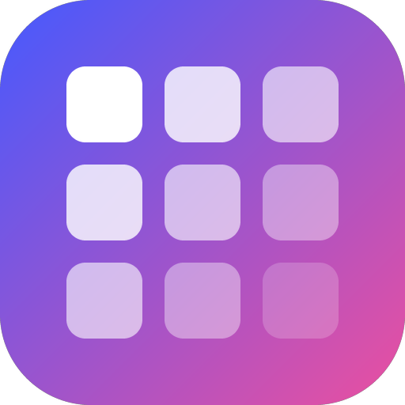
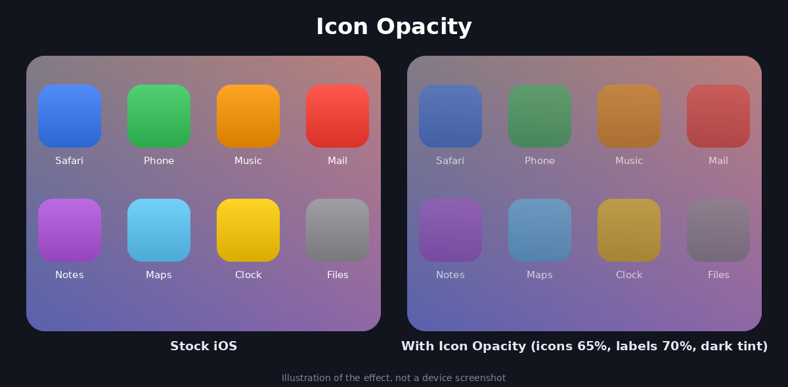

<p align="center">
  
</p>

<h1 align="center">Icon Opacity</h1>

<p align="center">
  Make your home screen icons and labels translucent and add a colour overlay,<br>
  so any wallpaper shows through. Live preview in Settings.
</p>

<p align="center">
  
  
  
</p>

<p align="center">
  <a href="https://zeusmaster150.github.io/iosiconopacity/"><b>Repo page</b></a> ·
  <a href="sileo://source/https://zeusmaster150.github.io/iosiconopacity/"><b>Add to Sileo</b></a> ·
  <a href="https://github.com/ZeusMaster150/iosiconopacity/actions">Builds</a>
</p>

<p align="center">
  
  <br><sub>Illustration of the effect, not a device screenshot.</sub>
</p>

## Features

- **Icon opacity**: a slider from 0.1 to 1.0 for every home screen icon.
- **Label opacity**: separate slider for the text under the icons.
- **Colour overlay**: pick red, green and blue plus the overlay opacity, to match the icons to any wallpaper or theme.
- **Live preview** in Settings: a Safari icon on a colourful background shows the result while you drag the sliders.
- **Instant apply**: changes show on the home screen without a respring.
- Own page in **Settings → Icon Opacity**.

## Install

### From the repo (Sileo, Zebra, Cydia)

1. Open Sileo and go to **Sources → +**.
2. Add the source: `https://zeusmaster150.github.io/iosiconopacity/`
3. Find **Icon Opacity** and install it.

Requires **PreferenceLoader** and **MobileSubstrate** (usually installed with the jailbreak).

### From a .deb

Download the latest `.deb` from `docs/debs/` and open it in Filza, then respring.

## Usage

Open **Settings → Icon Opacity** and move the sliders. The top card shows a preview. Changes are applied to the home screen immediately.

| Setting | Range | Meaning |
|---|---|---|
| Icon opacity | 0.1 – 1.0 | 1.0 = stock |
| Label opacity | 0 – 1.0 | 1.0 = stock, 0 = hidden |
| Overlay colour | R, G, B: 0 – 1 | 0/0/0 black, 1/1/1 white |
| Overlay opacity | 0 – 1.0 | 0 = no overlay |

## Compatibility

Written for iOS 12 (arm64). It has been run on an iPhone 6 with iOS 12.5.8. Other versions are untested.

Known limitations:

- The overlay is a rounded rectangle fitted to the icon, so corners may differ slightly from the real icon shape.
- Label opacity may fight with system label fade animations in rare cases.

## Build

The project uses [Theos](https://theos.dev). A GitHub Actions workflow (`.github/workflows/build.yml`) builds the tweak and updates the repo in `docs/` (published with GitHub Pages).

To build locally with Theos installed:

```sh
make package
```

## Русская версия

**Icon Opacity** делает иконки на рабочем столе и подписи под ними прозрачными и добавляет цветной слой поверх иконок, чтобы обои было лучше видно.

- Прозрачность иконок и отдельно подписей.
- Цветной слой: красный, зелёный, синий и его прозрачность.
- Предпросмотр на иконке Safari прямо в настройках.
- Всё применяется сразу, без ресинга.

**Установка:** Sileo → Источники → «+» → `https://zeusmaster150.github.io/iosiconopacity/` → найти Icon Opacity. Нужен PreferenceLoader.

Настройки лежат в **Настройки → Icon Opacity**.

## License

[MIT](LICENSE)
